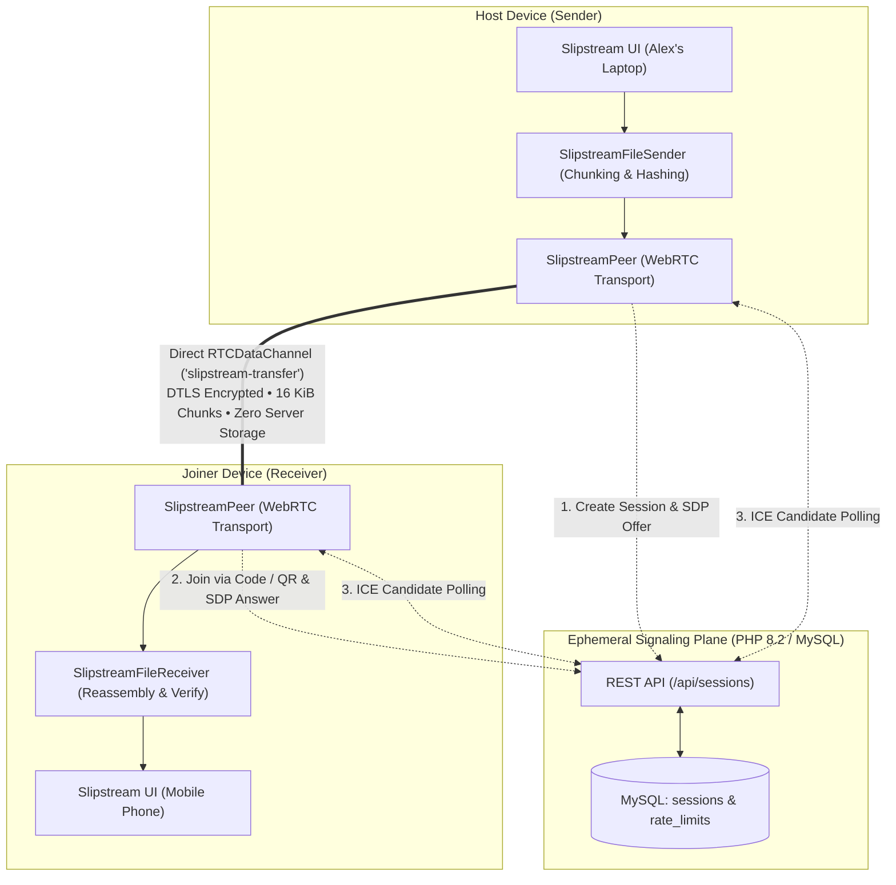
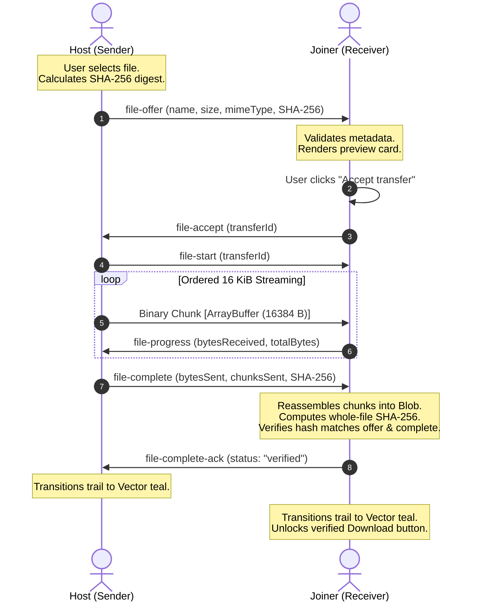

# Slipstream Graphics & Visual Assets

This directory contains vector graphics (SVGs), presentation visuals, and architecture diagrams created for the **Slipstream** WebRTC file transfer system as part of the Phase 2 QA and presentation deliverables.

---

## 1. Vector Graphics Catalog

| Graphic File | Format | Description | Target Use Case |
|---|---|---|---|
| [`system_architecture.svg`](file:///c:/Users/Demilade%20Subair/OneDrive%20-%20Ashesi%20University/3rd%20year/1st%20Semester/Web%20Tech/Final%20Project/slipstream/qa/graphics/system_architecture.svg) | SVG (1000x680) | Comprehensive system architecture showing Browser A (Host / Sender), Ephemeral PHP/MySQL Signaling Plane, Browser B (Joiner / Receiver), and the direct DTLS-encrypted WebRTC DataChannel. | Architecture documentation, final report, and project presentation slide decks. |
| [`protocol_sequence.svg`](file:///c:/Users/Demilade%20Subair/OneDrive%20-%20Ashesi%20University/3rd%20year/1st%20Semester/Web%20Tech/Final%20Project/slipstream/qa/graphics/protocol_sequence.svg) | SVG (960x720) | Step-by-step sequence diagram of the Phase 2 file transfer protocol (`file-offer` &rarr; `file-accept` &rarr; `file-start` &rarr; binary chunks &rarr; `file-progress` &rarr; `file-complete` &rarr; SHA-256 verification &rarr; `file-complete-ack`). | Protocol design documentation, technical defense, and code walkthroughs. |
| [`chunking_backpressure.svg`](file:///c:/Users/Demilade%20Subair/OneDrive%20-%20Ashesi%20University/3rd%20year/1st%20Semester/Web%20Tech/Final%20Project/slipstream/qa/graphics/chunking_backpressure.svg) | SVG (960x520) | Visualization of 16 KiB chunk slicing via `File.slice()` and the back-pressure flow control mechanism (1 MiB high-water mark pause, 256 KiB low threshold resume). | WebRTC engineering analysis and memory safety demonstration. |

---

## 2. Mermaid Source Diagrams

For markdown renderers and presentation decks that support inline Mermaid:

### Architecture Flowchart

### Protocol Sequence Diagram

